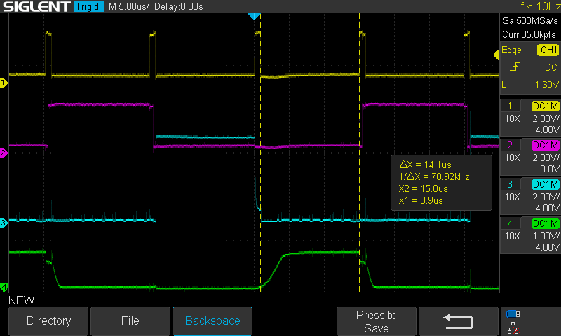

## Display digit balancing

Each digit on the numeric display needs to be shown for an equal length of time so each digit has the same brightness. These oscilloscope screenshots show how long each digit sink is active.

The circuit is running the main loop, continually running the display_glyphs_oe function. The glyphs are set by the day delta "888".

| Oscillopscope channel | Net                              |
| --------------------- | -------------------------------- |
| CH1                   | OE (3.3V GPIO)                   |
| CH2                   | DG0 (3.3V GPIO)                  |
| CH3                   | DG1 (5V shift register output)   |
| CH4                   | DG2 (digit sink transistor base) |

To measure how long each digit is shown, we measure from when OE goes low for that digit to when when OE goes HIGH.

DG0 length: 14.1us
DG1 length: 14.1us
DG2 length: 14.1us

### DG0 (ones place)

### DG1 (tens place)

### DG2 (hundreds place)

