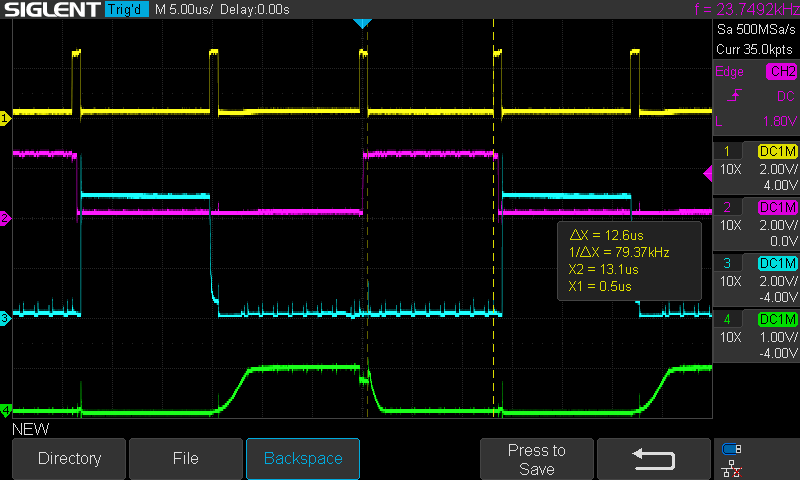
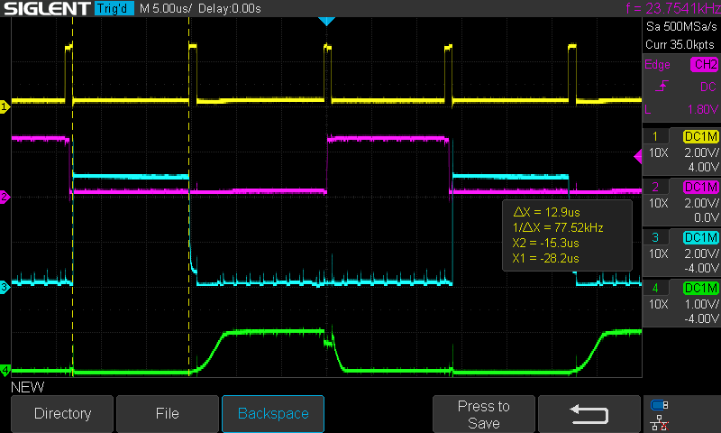
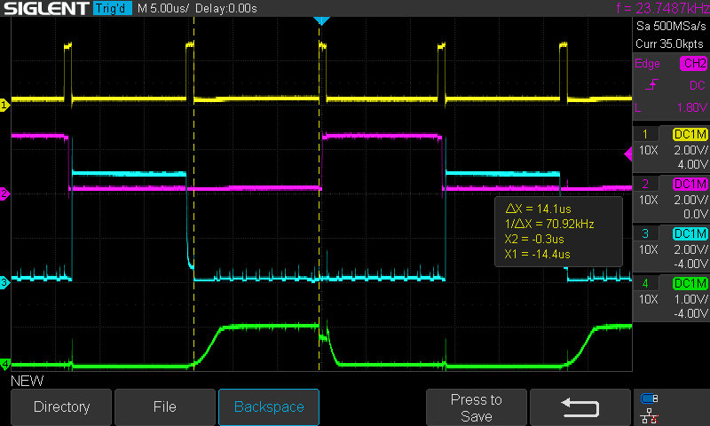
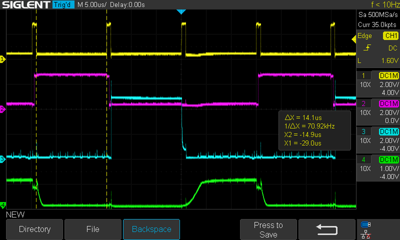
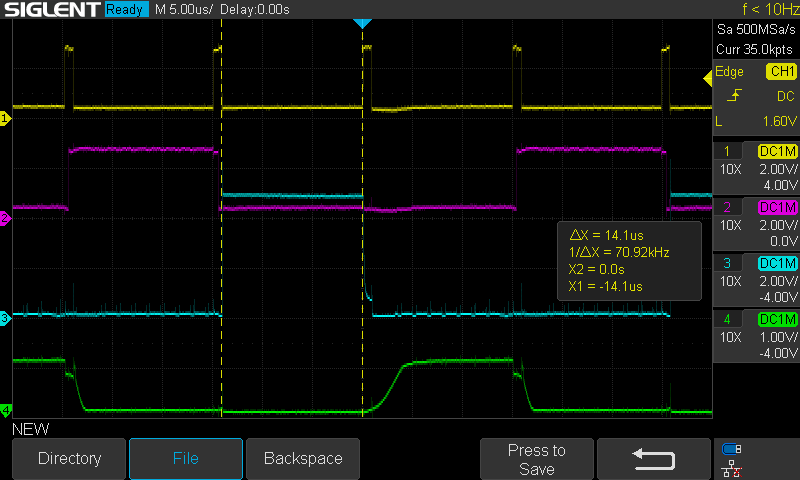

# Display digit balancing

Each digit on the numeric display needs to be shown for an equal length of time so each digit has the same brightness.

To measure how long each digit is shown, we measure from when OE goes low for that digit to when when OE goes HIGH.

### Oscilloscope nets

| Oscilloscope channel | Net                              |
| -------------------- | -------------------------------- |
| CH1                  | OE (3.3V GPIO)                   |
| CH2                  | DG0 (3.3V GPIO)                  |
| CH3                  | DG1 (5V shift register output)   |
| CH4                  | DG2 (digit sink transistor base) |

### Test conditions

The program is running the main loop.

```c++
do {
    display_glyphs_oe(glyphs);
} while (busy_flags == 0x00);
```

Glyphs are set to "888".

## Pre-balance results

These are the oscilloscope results **without** the NOP call delays added to the ones and tens places in `display_glyphs_oe`.

* DG0 length: 12.6us
* DG1 length: 12.9us
* DG2 length: 14.1us

#### DG0 (ones place)



#### DG1 (tens place)



#### DG2 (hundreds place)



## Post-balance results

These are the oscilloscope results **with** 12 NOPs added to ones place and 10 NOPs added to the tens place in `display_glyphs_oe`.

* DG0 length: 14.1us
* DG1 length: 14.1us
* DG2 length: 14.1us

#### DG0 (ones place)



#### DG1 (tens place)



#### DG2 (hundreds place)


